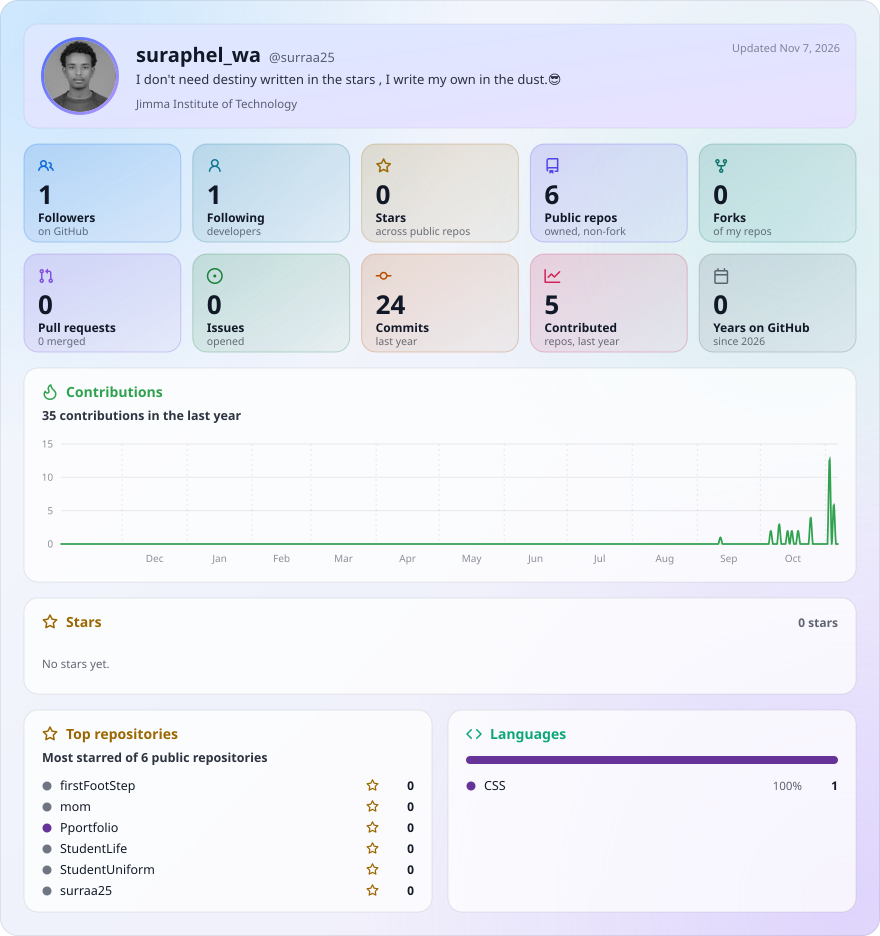

# 👋 Hello, I'm Surraa

### Computer Science Student | Aspiring Software Developer

  

- 🎓 Studying Computer Science at Jimma University.
- 🌱 Currently learning C++, Java, HTML, CSS, and JavaScript.
- 💻 Building projects and improving my programming skills.
- 🚀 Interested in Artificial Intelligence, Robotics, and Aerospace Technology.
- 🎯 Working toward becoming a skilled software developer.

### 🛠️ Languages and Tools

  

### 📌 Featured Project

- **My Portfolio:** [Pportfolio](https://github.com/surraa25/Pportfolio)

---

## 📊 GitHub Statistics

  <picture>
    <source media="(prefers-color-scheme: dark)" srcset="./glancecard/profile-dark.svg">
    
  </picture>

---

### 📫 Connect with me

- GitHub: [@surraa25](https://github.com/surraa25)

---

⭐ *Always learning. Always building. Always exploring.*
